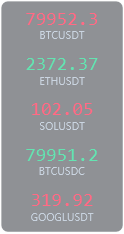
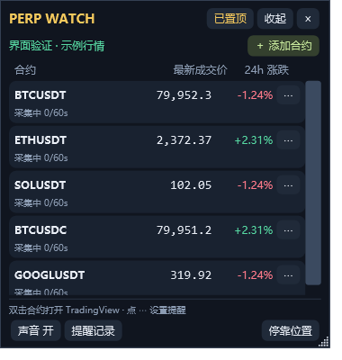

# Perp Watch · 币安合约桌面浮窗

轻量的 Windows 行情浮窗：把关注的合约放在屏幕边缘，悬停展开，设置价格与快速涨跌提醒，双击打开 TradingView。

**Windows 10/11 · C# / WPF · .NET Framework 4.8 · MIT**

A compact Windows desktop widget for Binance perpetual markets, with translucent edge-docked tiles, price alerts and TradingView shortcuts. The interface is in Simplified Chinese.

## 预览

下图是程序渲染的示例行情，非实时市场数据。小格背景具有透明通道；实际使用时可透出桌面。

| 侧边小格 | 展开窗口 |
| --- | --- |
|  |  |


## 功能

- 真正半透明的行情小格；左右竖排、上下横排；拖动自动吸附最近边缘。
- 悬停临时展开，移开收回；单击保持展开，Esc 收起。
- 从币安公开合约目录加载 USDT、USDC 和传统金融永续；支持分类及部分中文资产名称搜索。
- 上下限到价提醒、指定时间窗口内快速涨跌提醒，带声音、记录和同方向冷却。
- 双击展开窗口中的行情行，在默认浏览器打开对应 TradingView 币安永续图表。
- 自动重连、过期标识；低成交合约显示带标记的价格快照。
- 本地保存自选、报警与停靠位置；无需 API Key，不接入账户或下单。

## 下载与启动

从仓库的 **Releases** 页面下载 `PerpWatch-v2.0.0-windows.zip`，解压到可写目录后运行 `PerpWatch-v2.exe`。如果还没有已发布的 Release，可以按下方步骤从源码构建。

需要 Windows 10/11 与 .NET Framework 4.8，不需要 Python、Node.js 或 .NET SDK。目前提供未签名的便携程序，没有安装器或自动更新。

已有版本升级：先退出旧浮窗，再将新版程序放入原目录。保留同目录 `data` 文件夹；不要同时运行新旧版本。

完整操作和报警规则见 [使用说明](使用说明.md)。

## 构建与验证

在 **Windows PowerShell 5.1** 中进入源码目录：

```powershell
.\build.ps1 -Test -OutputName PerpWatch-v2.exe
```

使用系统自带 .NET Framework 编译器，不下载第三方依赖。42 项离线测试覆盖报警、重复触发、行情解析、合约筛选、设置与窗口状态；测试数据为人工构造的固定样例，不依赖交易所当日上架列表。

运行 23 项程序内界面检查（会短暂创建测试窗口，使用隔离配置）：

```powershell
$p = Start-Process .\PerpWatch-v2.exe -ArgumentList '--ui-test' -Wait -PassThru
if ($p.ExitCode -ne 0) { throw 'UI checks failed' }
```

报告和渲染图写入 `verification/`。这些检查覆盖控件、状态、透明像素和布局；尚未完成真实鼠标操作的全流程自动验收。

可选的实时网络检查：

```powershell
$p = Start-Process .\PerpWatch-v2.exe -ArgumentList '--probe' -Wait -PassThru
$p.ExitCode
```

结果写入 `probe-result-v2.json`，依赖当地网络和交易所当前合约列表。无推送的合约会单独记录。

生成便携包及 SHA-256 校验文件：

```powershell
.\package.ps1
```

GitHub Actions 在 Windows 上构建、运行离线测试并生成可下载的构建产物。真实网络检查与桌面界面检查需另外执行。

## 数据与提醒边界

行情使用最新成交价，不是标记价格。到价条件包含等号，首次实时价格已越线也会触发；触发一次后停用，需手动重新启用。

快速涨跌比较当前价与指定秒数前的价格，需要积累完整观察窗口。断线或推送中断超过 15 秒会重建窗口。**价格快照不触发提醒，也不计入涨跌窗口。**

程序关闭、电脑睡眠、断网时无法监控；推送间隔内的瞬时越线可能遗漏。传统金融品种指币安提供的对应永续合约，不是直接连接股票或商品交易所。可用合约随币安目录变化；TradingView 是否收录对应图表也由其决定。

设置和记录只保存在程序目录的 `data/`；程序使用币安公开行情接口，打开图表时访问 TradingView。提交问题时请勿附上个人设置或完整日志。

## 源码结构

| 文件 | 用途 |
| --- | --- |
| `Core.cs` | 设置、价格报警、记录和持久化 |
| `Market.cs` / `Models.cs` | 行情连接、快照、合约目录和状态模型 |
| `App.cs` / `MainWindow.xaml` | 主窗口、托盘和提醒 |
| `Dock.cs` / `Dialogs.cs` | 透明小格、停靠、添加与报警对话框 |
| `Tests.cs` / `UiChecks.cs` | 离线逻辑测试与程序内界面检查 |

欢迎通过 Issues 反馈问题，通过 Pull Requests 改进。请附 Windows 版本、显示缩放比例和复现步骤；代码修改后执行离线测试，涉及窗口交互时补做界面检查。

## 许可证与参考

采用 [MIT License](LICENSE)。开源项目及接口参考见 [REFERENCES.md](REFERENCES.md)。本项目为独立开发，与 Binance、TradingView 无隶属或官方合作关系。
